<picture>
  <source media="(prefers-color-scheme: dark)" srcset="assets/banner-dark.svg">
  <source media="(prefers-color-scheme: light)" srcset="assets/banner-light.svg">
  
</picture>

 

### About

Backend developer who builds and ships things end to end, from the database and the API to the server they run on.
Most of my work lives in two places: **web platforms** built with Python and Flask, and the **Telegram ecosystem**, where I write bots, Mini Apps and MTProto clients in Go.

I care about software that is simple to run, fast to respond, and easy to reason about a year later.

 

### What I Build

<table>
  <tr>
    <td width="33%" valign="top">
      <b>Web Platforms</b>  
      Full-stack Flask applications with authentication, admin dashboards, file handling and web push notifications, deployed behind Nginx and Gunicorn.
    </td>
    <td width="33%" valign="top">
      <b>Telegram Ecosystem</b>  
      Bots, Mini Apps and MTProto user clients in Go. Session management, rate-limit aware request pipelines and real-time event handling.
    </td>
    <td width="33%" valign="top">
      <b>Automation &amp; Data</b>  
      Scrapers, monitors and data pipelines that collect, clean and analyse information from APIs and web sources on a schedule.
    </td>
  </tr>
</table>

 

### Tech Stack

<table>
  <tr>
    <td width="130"><b>Languages</b></td>
    <td></td>
  </tr>
  <tr>
    <td><b>Backend</b></td>
    <td></td>
  </tr>
  <tr>
    <td><b>Infrastructure</b></td>
    <td></td>
  </tr>
  <tr>
    <td><b>Tools</b></td>
    <td></td>
  </tr>
</table>

 

### Selected Work

| Project | Description | Stack |
| :-- | :-- | :-- |
| **Midad** | Digital library platform: online reading, book requests, orders and an admin dashboard. | Python · Flask · SQLite · Nginx |
| **Telegram Mini Apps** | Web apps that run inside Telegram, backed by Go services. | Go · JavaScript |
| **Telegram Clients** | MTProto automation clients for monitoring and data collection. | Go · gotd/td |

 

### How I Work

<table>
  <tr>
    <td width="33%" valign="top">
      <b>01 &nbsp; Ship end to end</b>  
      From schema to server config. A feature is done when it runs in production, not when it works on my machine.
    </td>
    <td width="33%" valign="top">
      <b>02 &nbsp; Keep it simple</b>  
      Fewer moving parts, fewer dependencies, clear code. Boring technology that stays up.
    </td>
    <td width="33%" valign="top">
      <b>03 &nbsp; Measure, then optimise</b>  
      Profile first, fix the real bottleneck, and respect the rate limits of every API I touch.
    </td>
  </tr>
</table>

 

### Get in Touch

Open to freelance work and collaboration on backend, web and Telegram projects.
The fastest way to reach me is through GitHub.

 

mustafaMazn &nbsp;/&nbsp; 2026

